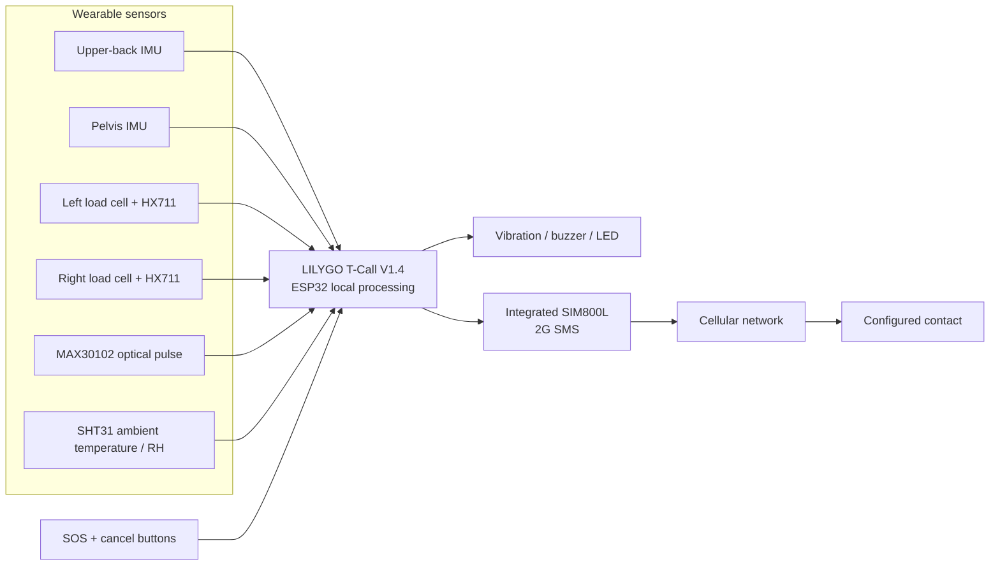

# AGRI-SAFE

**Wearable workload awareness and emergency communication for agricultural work**

AGRI-SAFE is a screen-free wearable concept for women working in Tunisian agriculture. It combines posture and supported-load measurements with ambient sensing, local feedback, and a physical SOS interface. The ESP32 performs local processing; the integrated SIM800L on the LILYGO T-Call V1.4 is reserved for emergency SMS.

> AGRI-SAFE is an ergonomic awareness and safety-support concept. It is not a medical device, does not diagnose illness or predict injury, and cannot guarantee SMS delivery or assistance.

## Design goals

- Make repeated bending and measured handle loads visible to the worker through configurable, task-specific cues.
- Keep sensing and decision logic local to the ESP32.
- Provide vibration, buzzer, and LED feedback without requiring a screen or phone.
- Allow a deliberate SOS request with a cancel window and bounded communication retries.
- Preserve measurement validity: unavailable or poor-quality signals stay unavailable rather than becoming invented values.
- Keep the design practical for rural use, including comfort, mounting, power, and maintainability.

## System overview



See [system architecture](docs/architecture.md), [hardware plan](docs/hardware.md), and [wiring overview](docs/wiring.md).

## Baseline components

| Subsystem | Baseline | Purpose |
|---|---|---|
| Controller / communication | LILYGO TTGO T-Call V1.4, ESP32 + integrated SIM800L | Local processing and 2G SMS |
| Posture | Two IMUs; select one model for both (MPU6050 or ICM-42670-P) | Relative upper-back / pelvis orientation |
| Handle load | Two load cells + two HX711 modules | Separate left and right handle load estimates |
| Pulse | MAX30102 | Quality-gated pulse-rate estimate |
| Environment | SHT31 | Ambient temperature and relative humidity |
| Feedback | Vibration motor with driver, buzzer with suitable driver, status LED | Local, screen-free cues |
| Interface / power | Guarded SOS and cancel buttons; compatible protected 1-cell battery | Emergency interface and portable power |

The two instrumented handles are mechanical accessories: the handle force must pass through the load cell. A sensor attached to an ordinary glove does not measure supported container load.

## Firmware

The PlatformIO project in [`firmware/`](firmware/) contains reusable workload and emergency-state logic for the ESP32 Arduino framework. Hardware pin assignments for sensors and actuators are deliberately centralized in `firmware/include/pins.h`; set them only after checking the exact board revision, breakout boards, voltage levels, and mechanical assembly. The T-Call's modem and power-management pins are reserved by the board and must not be reassigned.

The code keeps independent validity flags for measurements. Posture and load alerts are configurable reminders, not universal safety thresholds. The SOS flow distinguishes a command accepted by the modem from SMS delivery or a human response.

## Repository map

```text
AGRI-SAFE/
├── README.md
├── docs/
│   ├── architecture.md
│   ├── hardware.md
│   └── wiring.md
├── diagrams/
│   ├── architecture.mmd
│   └── wearable-placement.mmd
└── firmware/
    ├── platformio.ini
    ├── include/
    │   ├── config.h
    │   ├── pins.h
    │   └── types.h
    └── src/
        ├── main.cpp
        ├── posture.cpp
        ├── load_estimator.cpp
        └── sos_controller.cpp
```

## Build

1. Install Visual Studio Code and PlatformIO.
2. Open `firmware/` as the PlatformIO project.
3. Confirm the exact T-Call revision and sensor breakout variants.
4. Assign the unallocated sensor / actuator pins in `include/pins.h` from the board schematic and actual wiring.
5. Set warning thresholds and the emergency contact in `include/config.h` (keep personal contact details out of public commits).
6. Build and flash for `esp32dev` with the appropriate board package.

The configured contact number is a placeholder. SMS cannot be sent until a valid number, SIM, supported 2G service, and modem setup are configured.

## Safety and measurement limits

- Relative trunk inclination depends on sensor alignment, mounting stability, calibration, and orientation estimation. It is not an injury predictor.
- HX711 measurements describe force transferred through the instrumented handles only; they do not measure spinal or total body load.
- MAX30102 pulse estimates can be invalid during motion or poor optical contact; this project does not provide clinical readings.
- SHT31 measures ambient temperature and humidity, not core temperature, WBGT, dehydration, or heat illness.
- SIM800L is a 2G modem. Availability depends on the local operator and network. No GPS/GNSS is included.
- SMS submission is not proof of delivery, reading, or rescue.
- Battery runtime, sensor accuracy, mechanical capacity, and wearer comfort require measurement and evaluation on the completed assembly.

## Development sequence

1. Confirm board revision, sensor variants, component inventory, and electrical limits.
2. Verify pin availability, I2C addresses, bus sharing, and the modem's peak-current supply.
3. Bring up and calibrate one subsystem at a time.
4. Integrate local rules and feedback.
5. Integrate SOS/SMS with a bounded retry policy.
6. Evaluate measurement quality, power, mechanics, comfort, and usability under controlled conditions.

## References

- [LILYGO T-Call SIM800 official repository](https://github.com/Xinyuan-LilyGO/LilyGo-T-Call-SIM800) — board examples, schematics, and revision-specific modem/power pin references.
- [SIMCom SIM800 series](https://www.simcom.com/product/SIM800.html) — modem family information.

## License

No license has been selected. Add a license only after the project owner chooses how the work may be reused.
