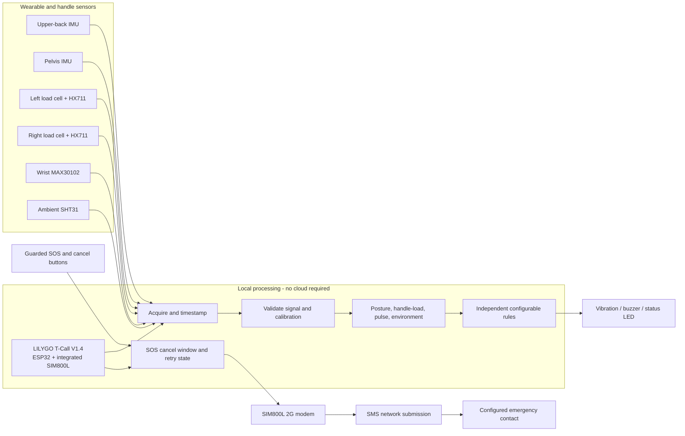
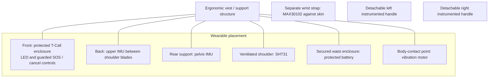

# Amnora

**A wearable workload-awareness and emergency-support system for agricultural work**

Amnora is a screen-free wearable system concept for women working in Tunisia's rural and peri-urban agricultural economy. It brings together posture sensing, load measurement through purpose-built carrying handles, ambient sensing, local feedback, and a physical SOS interface.

The system is designed around the **LILYGO T-Call V1.4 with ESP32 and integrated SIM800L**. Measurements are processed locally. The modem is reserved for emergency SMS; the design does not require a phone app, cloud service, display, GPS, or machine-learning model.

> **Scope:** Amnora provides ergonomic workload awareness and a way to request assistance. It is not a medical device, does not diagnose illness or predict injury, and cannot guarantee that an SMS will be delivered or acted upon.

[Architecture](docs/architecture.md) | [Hardware](docs/hardware.md) | [Wiring](docs/wiring.md) | [Firmware](firmware/) | [Diagrams](diagrams/)

### Project status

The repository contains the ESP32 firmware modules, system documentation, and design diagrams. The public configuration deliberately leaves optional peripheral GPIOs unassigned, load-cell scale factors at zero, and the emergency number as a placeholder. Complete the board-specific setup below before using the firmware with connected hardware.

---

## Why Amnora

Agricultural and artisanal work can involve repeated bending, manual handling, long work periods, and exposure to hot conditions. Amnora focuses on practical indicators that can be measured by a wearable system and used to prompt awareness:

- Relative upper-back and pelvis orientation, with time spent above a configurable posture threshold.
- Load transferred through two instrumented carrying handles, measured independently on the left and right.
- Wrist optical pulse estimate when the signal is usable.
- Ambient temperature and relative humidity.
- Local vibration, buzzer, and LED cues, plus a guarded SOS/cancel interaction.

The indicators remain separate. The firmware does not combine them into a medical score or universal injury-risk rating.

## System at a glance



The block diagram is also available as [`diagrams/architecture.mmd`](diagrams/architecture.mmd). Component placement is shown in [`diagrams/wearable-placement.mmd`](diagrams/wearable-placement.mmd).

## Hardware baseline

| Function | Component | What it measures or does |
|---|---|---|
| Controller and communication | LILYGO T-Call V1.4, ESP32 + SIM800L | Local processing and 2G SMS |
| Relative posture | Two matching MPU6050 IMUs in the current firmware target | Upper-back orientation relative to pelvis |
| Handle load | Two load cells + two HX711 modules | Separate force-derived estimates for each instrumented handle |
| Pulse | MAX30102 | Optical pulse-rate estimate with signal-quality gating |
| Environment | SHT31 | Ambient temperature and relative humidity |
| Worker feedback | Vibration motor, buzzer, LED with suitable drivers | Screen-free local cues |
| Emergency input | Guarded SOS and cancel buttons | Deliberate request and cancellation window |
| Power and garment | Compatible protected single-cell battery, vest and enclosures | Portable integration and sensor positioning |

Two MPU6050 devices use I2C addresses `0x68` and `0x69`; the second device must have its AD0 address strap set accordingly. The project description also allows an ICM-42670-P pair as an alternative hardware direction; that sensor needs a matching driver before selecting it for this firmware target.

The load cells belong in purpose-built handles. The intended force must pass through each load cell; mounting a sensor on an ordinary glove does not measure container load.

## Wearable layout



The [wearable-placement diagram source](diagrams/wearable-placement.mmd) adds the handle load-cell mounting principle.

## Repository map

```text
Amnora/
|-- README.md
|-- docs/                  # Architecture, hardware inventory, wiring
|-- diagrams/              # Mermaid architecture and placement diagrams
`-- firmware/
    |-- platformio.ini
    |-- include/            # Configuration and module interfaces
    `-- src/                # Sensor, processing, feedback, and SOS modules
```

## Firmware design

The ESP32 firmware is organized around small modules rather than one application loop:

- **Sensor acquisition:** timestamped IMU, environment, HX711 raw-count, and MAX30102 samples, with per-channel availability.
- **Posture processing:** complementary orientation filtering, neutral calibration, and dwell tracking.
- **Load processing:** independent tare and scale calibration for each handle.
- **Rules and feedback:** separate configurable posture and load reminders.
- **Input handling:** debounced SOS and cancel controls.
- **Emergency state machine:** cancellation window, modem readiness check, bounded retry, and distinct "submitted" versus "delivered" semantics.

See [`docs/architecture.md`](docs/architecture.md) for the data path and state transitions. Board-specific modem pins are reserved in [`firmware/include/pins.h`](firmware/include/pins.h); sensor and actuator GPIO choices must be made against the exact board revision and assembled wiring before connection.

### Serial setup and calibration

At 115200 baud, the serial monitor accepts:

- `c` - collect 40 paired IMU samples (about 2 seconds) for the relative upper-back/pelvis reference. Stand comfortably neutral and hold still; the calibration is rejected if the relative angle varies too much.
- `z` - collect 16 samples per configured HX711 channel and average them for tare. Keep each instrumented handle unloaded until the serial monitor reports completion.
- `?` - print the available commands.

Calibration runs inside the normal scheduler, so sensor acquisition and SOS processing continue while samples are collected. If calibration times out or the wearer moves during neutral capture, correct the condition and repeat it.

Telemetry is emitted as one JSON object per line. Raw HX711 counts are included so the two handle channels can be calibrated independently. After tare, place a known reference mass on one handle at a time and calculate `counts_per_kg = (loaded_counts - tare_counts) / known_mass_kg`. Set separate left and right constants in `firmware/include/config.h`. A zero calibration factor keeps that channel's kilogram value unavailable.

## Build and configure

1. Install VS Code and the PlatformIO extension.
2. Open the `firmware/` directory as a PlatformIO project.
3. Select the `ttgo-t-call-v1_4` environment from `firmware/platformio.ini`.
4. Confirm the board is the **SIM800L/IP5306 T-Call V1.4** variant, not a visually similar revision or LTE variant.
5. Review `firmware/include/pins.h` and assign only exposed, unused pins supported by the board schematic and the actual breakout modules.
6. Set the two HX711 calibration factors only after calibration with known reference loads. Do not reuse a factor between handles without evidence.
7. Set task-specific alert thresholds in `firmware/include/config.h`.
8. Set the emergency number locally. Keep personal phone numbers and SIM credentials out of public commits.
9. Build and flash using PlatformIO after the board and pin configuration have been reviewed.

The sensor bus uses GPIO 21/22, which are also used by the T-Call's IP5306 power controller. Review the shared-bus pull-ups, voltage levels, addresses, and total capacitance in [hardware.md](docs/hardware.md) before connecting the sensor breakouts.

The SIM800L path depends on a valid SIM, cellular registration, operator support for 2G in the work area, and adequate power during transmission. The example contact number is intentionally invalid until locally configured.

## Design constraints and measurement limits

- **Posture:** relative angle depends on fixed sensor mounting, axis alignment, neutral calibration, and filtering. A threshold is a configurable reminder, not a universal safe/unsafe boundary.
- **Handle load:** estimates describe force transferred through the instrumented handle only. They do not measure total object weight when another support carries part of the load, spinal force, shoulder loading, or body biomechanics.
- **Pulse:** wrist PPG is sensitive to movement, fit, ambient light, and skin contact. Firmware rejects saturated or stale signals and applies a relative signal-amplitude gate plus plausible, consistent beat intervals. These checks reduce some poor readings but do not identify every motion artifact. Invalid or low-quality readings remain unavailable. It is not ECG or a clinical result.
- **Environment:** SHT31 readings are ambient temperature and relative humidity. They are not core temperature, WBGT, dehydration, or heat-illness measurements.
- **Communication:** the board contains a 2G SIM800L, not LTE or GNSS. No location is sent. Network acceptance is not proof of delivery, reading, or assistance. If a submission response is lost after network acceptance, a bounded retry may produce a duplicate SMS.
- **Power and mechanics:** runtime, load capacity, measurement accuracy, comfort, and enclosure durability depend on the final assembly and must be evaluated on that assembly.

## Technical references

- [LILYGO T-Call SIM800 repository](https://github.com/Xinyuan-LILYGO/LilyGo-T-Call-SIM800) - board variants, examples, pin references, and schematic links.
- [Adafruit MPU6050 Arduino library](https://github.com/adafruit/Adafruit_MPU6050) - MPU6050 I2C driver used by the firmware.
- [Adafruit SHT31 Arduino library](https://github.com/adafruit/Adafruit_SHT31) - SHT31 I2C driver.
- [SparkFun MAX3010x Arduino library](https://github.com/sparkfun/SparkFun_MAX3010x_Sensor_Library) - MAX30102 device access.
- [Bogde HX711 Arduino library](https://github.com/bogde/HX711) - HX711 ADC interface.
