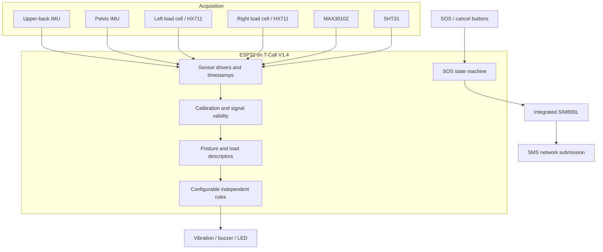

# System architecture

## Data flow

## Separation of responsibilities

1. **Acquisition:** drivers produce timestamped raw samples and sensor-health state.
2. **Calibration and quality:** apply neutral reference, load tare/calibration factors, and reject invalid or stale readings.
3. **Descriptors:** calculate relative trunk angle, bending duration, per-handle supported load, pulse estimate when signal quality allows, and ambient conditions.
4. **Rules:** independently compare valid measurements with configurable task-specific thresholds. No composite medical or injury-risk score is generated.
5. **Feedback:** schedule nonblocking tactile, audible, and visual patterns.
6. **Emergency communications:** handle button confirmation/cancellation, modem readiness, bounded SMS submission attempts, and user feedback.

## Emergency sequence

```mermaid
stateDiagram-v2
  [*] --> Idle
  Idle --> CancelWindow: guarded SOS press
  CancelWindow --> Idle: cancel press
  CancelWindow --> ModemCheck: timeout / explicit confirm
  ModemCheck --> Submitting: modem ready and network registered
  ModemCheck --> Failed: modem/network unavailable
  Submitting --> Submitted: modem reports submission accepted
  Submitting --> RetryWait: explicit submission failure, retries remain
  RetryWait --> ModemCheck: retry timer expires
  Submitting --> Failed: timeout / retry limit reached
  Submitted --> Idle: report submitted; delivery unconfirmed
  Failed --> Idle: report failure locally
```

## Measurement validity

Every sensor channel has a validity state and timestamp. A missing or poor-quality signal is marked unavailable. Sensor failure must not be converted to a normal-looking number. Pulse-rate quality gating and sensor drivers are explicit extension points for the selected libraries and breakout revisions.
