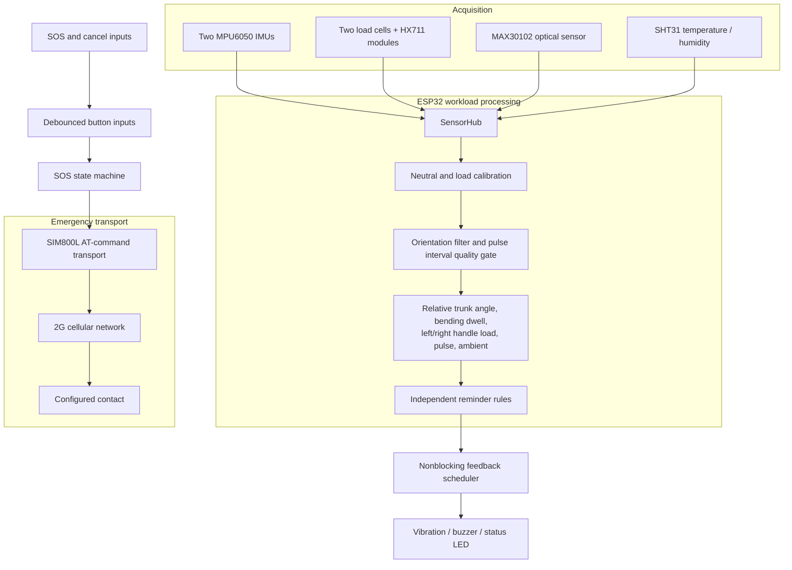

# Amnora system architecture

Amnora keeps sensing, local processing, user feedback, and emergency communication as separate modules. Sensor values retain their own validity and timestamps; one failed sensor does not invalidate unrelated channels.

## Data path

## Firmware modules

| Module | Responsibility |
|---|---|
| `SensorHub` | Initializes the I2C sensors, samples the two IMUs and SHT31, reads available HX711 channels, and reports pulse measurements. |
| `ComplementaryAngleFilter` | Blends accelerometer angle with gyro rate for the configured sagittal axis. |
| `RelativePostureCalibration` | Captures the upper-back to pelvis offset in a comfortable neutral stance. |
| `PostureTracker` | Tracks continuous dwell above the warning threshold, using a lower release threshold to reduce alert chatter. |
| `LoadEstimator` | Converts tared raw HX711 counts using a separately calibrated counts-per-kilogram factor for each handle. |
| `PulseMonitor` | Reads MAX30102 IR samples, rejects saturated or stale signal, applies relative-amplitude and interval-quality gates, and exposes a median estimate only while recent beats remain plausible and consistent. |
| `FeedbackController` | Schedules tactile, audible, and LED pulses without delay loops. |
| `Sim800lTransport` | Performs power-on, network registration query, text-mode SMS submission, response parsing, and command timeouts without blocking. |
| `SosController` | Owns the cancel window, bounded attempts, modem/SMS timeouts, and communication state. |
| `ButtonDebouncer` | Emits stable press transitions for the guarded physical SOS and cancel switches. |

## Sampling and calibration

- The main scheduler requests a sensor frame every 50 ms.
- The SHT31 is read once per second and marked stale if no fresh value is available.
- Two MPU6050 devices use addresses `0x68` and `0x69`; the pelvis unit needs the alternate AD0 address.
- Enter `c` in the serial monitor while standing comfortably neutral. The firmware averages 40 paired IMU samples (about 2 seconds at the configured sample rate) and rejects the capture if relative-angle variation exceeds the configured stability limit.
- Enter `z` with the instrumented handles unloaded. Each configured HX711 channel averages 16 ready samples for tare; a missing stream times out instead of silently recording a partial tare.
- Calibration runs in the normal scheduler and has a bounded timeout. The serial monitor reports completion or failure. Each HX711 channel still needs its own calibrated counts-per-kilogram constant after tare.
- The MAX30102 sample rate is configured to 100 Hz. The pulse monitor rejects missing or saturated contact, excessive relative AC signal amplitude, stale beat detection, implausible intervals, and inconsistent short interval windows. These heuristic gates reduce some poor readings; they cannot reliably identify every motion artifact because the design has no wrist-mounted motion sensor.

## SOS sequence

```mermaid
stateDiagram-v2
  [*] --> Idle
  Idle --> CancelWindow: debounced physical SOS press
  CancelWindow --> Idle: debounced cancel press
  CancelWindow --> ModemCheck: cancel window expires
  ModemCheck --> Submitting: SIM registered
  ModemCheck --> RetryWait: registration failure / timeout
  Submitting --> Submitted: modem returns +CMGS and OK
  Submitting --> RetryWait: SMS error / response timeout
  RetryWait --> ModemCheck: retry delay; attempts remain
  RetryWait --> Failed: retry limit reached
  Submitted --> Idle: next emergency request
  Failed --> Idle: next emergency request
```

`Submitted` means the modem/network accepted the submission response. It does not mean the recipient's handset received, displayed, or was answered by the SMS. The message explicitly states that the device has no GPS location capability.

The transport sequence is `AT` -> `AT+CREG?` -> `AT+CMGF=1` -> `AT+CMGS="number"` -> message body plus Ctrl-Z. Each waiting state has a deadline. Recipient text is restricted to a plus sign followed by digits, and the message buffer rejects control characters that could terminate the SMS unexpectedly.

Feedback uses short nonblocking pulse patterns. Posture and load reminders trigger on the transition into an alert, while the SOS and modem events use their own patterns. The board LED is treated separately from the external motor and buzzer driver outputs.

## Failure behavior

- Sensor init or read failure invalidates that channel and leaves other channels running.
- An uncalibrated load channel stays unavailable; raw counts are not presented as kilograms.
- Invalid or stale pulse samples stay unavailable; the application does not synthesize a value.
- Modem errors and timeouts return to a bounded retry path. Local monitoring continues while modem replies are pending.
- A timeout can be ambiguous: if the network accepted an SMS but its response was lost, a retry can submit a duplicate message.
- The public default emergency number is intentionally invalid; configure a real contact privately before any live SOS use.
