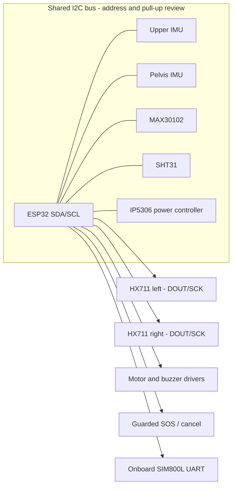

# Wiring overview

This is a functional connection architecture, not a final pin-by-pin harness. Fill GPIO values in `firmware/include/pins.h` only after checking the exact T-Call V1.4 schematic, exposed headers, breakout voltage levels, and board reservations in [hardware.md](hardware.md).

| Peripheral | Signal connections | Power / grounding | Notes |
|---|---|---|---|
| Upper-back IMU | Shared I2C SDA/SCL | Compatible logic rail; common ground | Configure address and orientation axis |
| Pelvis IMU | Same I2C bus if unique address | Compatible logic rail; common ground | MPU6050 requires distinct address from first IMU |
| MAX30102 | I2C SDA/SCL | Follow breakout specification | Typically address 0x57; ensure no conflict |
| SHT31 | I2C SDA/SCL | Follow breakout specification | Verify address straps and pull-ups |
| HX711 left | DOUT + SCK to two selected GPIOs | Module supply per its specification | One amplifier per load cell |
| HX711 right | DOUT + SCK to two selected GPIOs | Module supply per its specification | Separate channel/calibration |
| Vibration motor | GPIO to driver input | Motor supply sized for motor; common ground as topology requires | Never connect motor directly to a GPIO |
| Buzzer | GPIO to input/driver | Check buzzer current and voltage | Transistor driver when required |
| SOS / cancel buttons | Each to selected GPIO with defined pull state | Grounded switch input where appropriate | Debounce and guard against accidental press |
| Status LED | Existing onboard LED or external LED + resistor | Check polarity and GPIO drive | GPIO13 is listed as board LED on V1.4; reserve it |
| SIM800L | Integrated on T-Call; modem UART/power controlled by board | Board-managed | Do not wire an external modem; reserve board pins |

All grounds and power domains must follow the exact breakout and board specifications. Avoid connecting components until the supply voltage, logic compatibility, GPIO assignment, and current budget have been checked.
