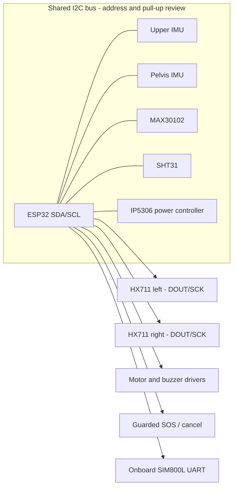

# Wiring overview

The sensor I2C lines in firmware use the T-Call's GPIO 21/22 pair, which is already used by the onboard IP5306 power controller. The remaining HX711 and actuator/button GPIOs stay disabled (`-1`) until the exact board schematic, exposed headers, and breakout voltage levels have been checked. See the address plan in [hardware.md](hardware.md).

| Peripheral | Signal connections | Power / grounding | Notes |
|---|---|---|---|
| Upper-back MPU6050 | GPIO 21 SDA, GPIO 22 SCL | Compatible logic rail; common ground | Address 0x68; fixed mounting axis |
| Pelvis MPU6050 | Same GPIO 21/22 bus | Compatible logic rail; common ground | Address 0x69; AD0 strap high |
| MAX30102 | Same GPIO 21/22 bus | Follow breakout specification | Address 0x57; verify pull-ups |
| SHT31 | Same GPIO 21/22 bus | Follow breakout specification | Address 0x44, alternate 0x45 if set |
| HX711 left | DOUT + SCK to two selected GPIOs | Module supply per its specification | One amplifier per load cell |
| HX711 right | DOUT + SCK to two selected GPIOs | Module supply per its specification | Separate channel/calibration |
| Vibration motor | GPIO to driver input | Motor supply sized for motor; common ground as topology requires | Never connect motor directly to a GPIO |
| Buzzer | GPIO to input/driver | Check buzzer current and voltage | Transistor driver when required |
| SOS / cancel buttons | Each to selected GPIO with defined pull state | Grounded switch input where appropriate | Debounce and guard against accidental press |
| Status LED | Existing onboard LED or external LED + resistor | Check polarity and GPIO drive | GPIO13 is listed as board LED on V1.4; reserve it |
| SIM800L | Integrated on T-Call; modem UART/power controlled by board | Board-managed | Do not wire an external modem; reserve board pins |

All grounds and power domains must follow the exact breakout and board specifications. Avoid connecting components until the supply voltage, logic compatibility, GPIO assignment, and current budget have been checked.

## Firmware calibration controls

With the PlatformIO serial monitor at 115200 baud:

- Send `c` while the wearer stands in a comfortable neutral posture and remains still for about 2 seconds. The firmware averages 40 paired IMU samples and rejects an unstable capture.
- Send `z` while each configured instrumented handle is unloaded. The firmware averages 16 ready HX711 samples per configured channel and reports completion or timeout.
- JSON telemetry includes raw HX711 counts for calibration. Use the known-mass formula in [hardware.md](hardware.md), then enter a separate counts-per-kilogram factor for each handle in `firmware/include/config.h`.

The SOS trigger is accepted only from the configured physical button pins. The public firmware defaults leave those pins unset, and the public emergency phone number is a non-routable placeholder.
